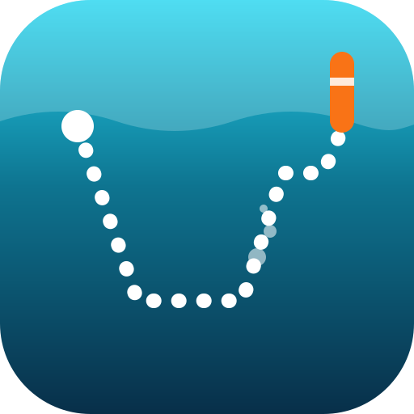

# DiveDeck

**Your AI dive companion.** Import the logs from your dive computer and get a data-driven debrief
of every dive: what went well, what to watch, and how you are progressing over time. Plan a trip in
[TripDeck](https://github.com/Torgh/tripdeck) and your companion prepares you for each of its dives
from your own log. It runs on the Claude or ChatGPT subscription you already have, **no API key
needed**, or with an API key. Your dives stay yours: on this PC, in OneDrive or on Google Drive.


DiveDeck works like its sister app TripDeck: your companion in Claude Code or Codex works on the log
directly through an MCP server, and the web app shows every change within seconds.

## What you get

**Your dive log**

- **UDDF import** from Subsurface, Shearwater Cloud, Garmin Dive, Suunto DM5, MacDive, DiveMate and
  other tools. Several dives per file, duplicates skipped, exporter quirks handled (Shearwater's CNS
  in whole percent and unused tank slots, any declared encoding).
- **Your dives as files.** One `*.dive.json` per dive next to the original UDDF file, on this PC, in
  OneDrive or on Google Drive. The originals are kept, so a newer parser reads your dives again and
  keeps what you filled in.
- **What the computer doesn't record:** site, location, buddy, notes, tank size and gas, on the dive's
  page or by telling your companion. A tank size gives the dive its gas consumption; the gas gives
  ppO2, CNS and END. *To sort out* lists what is still missing, and the dashboard saves a tank size or
  a gas for every dive that misses it in one go.

**Analysis** (rule-based, offline, no AI needed)

- gas consumption: surface RMV (L/min) and SAC (bar/min), and the gas left
- ascent and descent rates, with fast ascents marked on the profile
- safety stop and decompression stops, including deco-ceiling violations
- oxygen exposure: ppO2 per gas (following gas switches), CNS % and OTU
- END for trimix, hypoxic mixes, sawtooth profiles, NDL margin and computer alarms
- a 0–100 dive score, and trends across your dives

**Your companion**

- An agent that reads your dive, its profile and your whole history through tools, then writes a
  debrief: *dive summary → what went well → what to watch → compared with your history → focus for
  your next dive*. It quotes your numbers and never guesses a missing tank size or gas.
- It runs in Claude Code, Claude Desktop or Codex on your own subscription (through the MCP server),
  or in the app's chat with a Claude or ChatGPT API key.

**Trips**

- With TripDeck's MCP server connected to the same agent, your companion reads a trip's dive cards and
  prepares each one from your log: comparable dives (the same site first, then the closest depth),
  time since your last dive, gas consumption at the planned depth, ppO2, MOD and the richest nitrox,
  and the problems that keep coming back. It gives each card a verdict, *ready* or *check* with one
  line on what to sort out, shown here and on the TripDeck card, with a link back here.
- After the trip, link each logged dive to its card (or let your companion do it).

**The app**

- **Dashboard:** the coming trips with how far their preparation is, your totals, what is still to
  sort out, and progress charts (RMV, peak ascent rate, safety stop, score) with their direction,
  e.g. *worsening · 4.2 → 9.6 m/min*.
- **Dive log:** every dive with a thumbnail of its profile, its status, debrief and score; search by
  site, date, gas or number, and filters for the dives to watch, without a debrief or missing details.
- **A dive:** the score with the findings, three metric cards (profile beside your average, gas,
  safety), the debrief and the findings, and the profile: depth with the computer's deco stops, gas
  switches and fast ascents, then tank pressure, ppO2 and temperature on the same time axis. Every
  chart has a crosshair, works with the arrow keys and has a table view.
- **A trip:** a few checks before you go: the break before it (from your last logged dive, or the
  last dive of an earlier trip when that is later), what keeps coming back, your gas plan, the hours
  from the last dive to the flight against DAN's guidance (12 h after a single dive, 18 h after
  repetitive or multi-day diving), and the cards to check. Then the dive days by date with the days
  off between them; each card with its verdict, a one-line note and the full preparation.
- **Companion** chat (with an API key), **Import** with a summary of what came in, and **Settings**.
- **Get started** on the dashboard until the first steps are done: where the log lives, the first
  dives, and connecting your companion.
- **Metric or imperial** (m, bar, °C, L or ft, psi, °F, cu ft) for everything the pages show; the
  log, the analysis and the texts stay metric, and ppO2 stays in bar.
- A long debrief folds into its sections; saving a tank size or gas for several dives can be undone.
- Updates live, light and dark mode, works at phone width; every command has a copy button.

## Quick start

Requirements: [Bun](https://bun.sh) (it runs the MCP server and the app; Node.js 20.9+ also runs the
web app).

```bash
git clone https://github.com/Torgh/divedeck.git
cd divedeck
bun install
bun run dev          # http://localhost:3001 (bound to 127.0.0.1)
```

On **Import**, drop your UDDF files. No dive computer at hand? **Load sample dives** gives you nine
fictional dives that show a diver's progression from spring to autumn, including a trimix deco dive.

To update later: `git pull` and `bun install`. Your dives are parsed again when the parser improves.

Coming from **AI Diving Monitor**, the earlier Python version (tag
[`v0.1-python`](https://github.com/Torgh/divedeck/tree/v0.1-python))? **Copy my old log** on the
Import page (or `bun run migrate`) copies every dive and saved review from its database, which is only
read.

## Your companion

### With your Claude or ChatGPT subscription (MCP, no API key)

DiveDeck ships an [MCP](https://modelcontextprotocol.io) server. Connect it to Claude Code, Claude
Desktop or Codex and the agent becomes your dive companion, on your own Claude Pro/Max or ChatGPT
Plus/Pro plan at no extra cost. The server only exposes your dive log and the analytics.

In **Settings**, pick **Claude Pro/Max plan (via Claude Code)** or **ChatGPT Plus/Pro plan (via
Codex)**. The page checks whether the server is connected and shows the exact command for your
computer, with the environment that points it at the same data folder. Typically:

```bash
# Claude Code (sign in with /login)
claude mcp add --scope user divedeck -- ~/.bun/bin/bun /path/to/divedeck/mcp/server.ts

# Codex CLI (codex login → Sign in with ChatGPT)
codex mcp add divedeck -- ~/.bun/bin/bun /path/to/divedeck/mcp/server.ts
```

For Claude Desktop, add the same command to `mcpServers` in its config. The app itself never signs in
to your subscription or calls the model in these modes (Anthropic does not allow third-party apps to
use claude.ai sign-in); the model runs in Claude Code or Codex.

Then ask in plain language, or use the prompts:

```
/mcp__divedeck__dive-review      # debrief of your latest dive, compared with your history
/mcp__divedeck__dive-review 7    # debrief of dive 7 (1 = your oldest dive)
/mcp__divedeck__sort-out         # go through what your log is still missing, one dive at a time
/mcp__divedeck__trip-prep Dahab  # get ready for the dives of a TripDeck trip
> Import my dives from D:\Shearwater\export.uddf
> Dive 2 was at Koparki with a 12 L tank of EAN32.
> Is my gas consumption improving? What should I practise before my next deco dive?
```

Settings can also install a shorter `/dive-review` command for all Claude Code sessions.

| MCP tool | What it does |
|---|---|
| `list_dives` | The log with headline metrics, each dive's number and id |
| `get_overview` | The log at a glance: dives, the latest one, trends, and what is still to sort out (tank size, gas, site, debrief) |
| `get_dive_analysis` | Full metrics and findings for one dive, with what the diver filled in |
| `get_dive_profile` | Downsampled depth, pressure and temperature profile |
| `get_progress_trend` | Early vs recent comparison for a metric |
| `import_uddf` | Import a `.uddf` file or a folder of them |
| `update_dive` | Fill in the site, location, buddy, notes, the main tank's size and gas (`air`, `EAN32`, `Tx 18/45`…) |
| `save_dive_summary` | Store the debrief so the app shows it |
| `prepare_dive` | Get ready for a planned dive (site, depth, gas, date) from the log: experience, gas plan, ppO2/MOD, recurring problems |
| `save_trip_plan` | Store a TripDeck trip's dive cards with the preparation and verdict for each, the trip's flights, and the logged dives the cards turned into; answers each card's link for TripDeck |
| `get_trip_plans` | The saved trips; one trip's cards, verdicts and flights, with the dives logged on each card's day |
| `migrate_from_python` | Copy AI Diving Monitor's log, as `bun run migrate` does |

Dives are referred to by their number in the log (`1` = the oldest) or by their id.

**Trips.** Connect TripDeck's MCP server to the same Claude Code or Codex and run `trip-prep`. Your
companion reads the trip with TripDeck's `get_trip` and stores its dive cards with the preparation
here with its verdict for each card and the trip's flights, one `*.trip.json` per trip next to your
dives. Run it again after changing the trip in TripDeck: the cards and flights follow, and the
preparation and verdict of the cards that stayed are kept. It saves the same verdict on each TripDeck
card (TripDeck's `save_dive_prep`), so the board shows *Prepared* or *Check prep* with the one-line
summary and a link to the card here; a gas mix you told it goes on the card too. The no-fly time is
counted in local time from about the end of the last dive (90 minutes a dive from its start, 18:00
when the card has no time) to the departure; when a time is missing, it is counted cautiously. The app
never reads TripDeck's files, so it works wherever TripDeck keeps them. *Open in TripDeck* on a trip's
page goes to `http://localhost:3000` (see `NEXT_PUBLIC_TRIPDECK_URL`); *Forget here* removes the trip
from DiveDeck only.

### In the app, with an API key (optional)

In **Settings**, pick **Claude API key** or **ChatGPT API key**, paste the key (billed per use by the
provider) and choose the model, or *Load models from the API* to list the ones your key can use. The
**Companion** page then chats with you, and each dive's page can get a debrief, saved with the dive.

| Provider | API key | Example models |
|---|---|---|
| Claude (Anthropic) | [console.anthropic.com](https://console.anthropic.com/settings/keys) | `claude-opus-5-5`, `claude-sonnet-5-5`, `claude-haiku-5-5` |
| ChatGPT (OpenAI) | [platform.openai.com](https://platform.openai.com/api-keys) | `gpt-5`, `gpt-5-mini` |

The in-app companion uses the MCP server's read-only tools. On Claude it runs through the Anthropic
SDK's tool runner (`claude-opus-5-5` by default, effort `high`, with a server-side fallback when a
request is declined on the models that support it); on ChatGPT through OpenAI's Chat Completions. A
declined, cut-off or empty answer is shown, never saved as a debrief.

## Where your dives are stored

*Settings → Where your dives are stored* chooses **This PC**, **OneDrive** or **Google Drive**, and
the menu shows the current place. Switching copies your dives and trips to the new place (the copy
with the newer changes wins); the old place keeps its copy. The MCP server follows the choice at once.

- **This PC:** `dives/`, `originals/` and `trips/` in the data folder (see `DIVEDECK_HOME` below).
- **OneDrive:** a *DiveDeck* folder in your OneDrive folder on this PC (on Windows `%OneDrive%`, on
  macOS under `~/Library/CloudStorage/OneDrive-…`), synced by the OneDrive app, no sign-in needed. If
  it isn't found, enter the folder in Settings or set `DIVEDECK_ONEDRIVE_FOLDER`. When two computers
  change the same dive offline, the newer one wins.
- **Google Drive:** *My Drive › DiveDeck* (an older *AiDive* folder is renamed). The app asks only
  for `drive.file`: the files it created, never your other files. It needs your own OAuth client,
  once; Settings walks you through it:
  1. In Google Cloud, enable the **Google Drive API**.
  2. Under *Google Auth Platform*, set the audience to *External* and **publish the app** (apps left
     in testing mode are logged out every 7 days).
  3. Create an OAuth client of type *Web application* with the redirect URI
     `http://localhost:3001/api/auth/google/callback`. Using TripDeck on Google Drive already? Add
     this redirect URI to TripDeck's client and use the same client ID and secret here.
  4. Paste the client ID and secret into Settings and click **Connect Google Drive**.

Settings, API keys, the Google sign-in and the locks always stay in the data folder on this computer.

## Configuration

Everything is set in **Settings**; environment variables still work, and a saved setting wins.

| Variable | Default | Purpose |
|---|---|---|
| `DIVEDECK_HOME` | the folder of `DIVEDECK_DB` when that is set, else `~/.divedeck` | Data folder: settings, sign-in, locks, and the dives when they're stored on this PC |
| `DIVEDECK_CONFIG` | `config.json` in the data folder | Settings file |
| `DIVEDECK_ONEDRIVE_FOLDER` | found automatically | Your OneDrive folder |
| `ANTHROPIC_API_KEY`, `OPENAI_API_KEY` | – | API keys for the in-app companion |
| `DIVEDECK_PROVIDER`, `DIVEDECK_MODEL` | Claude, `claude-opus-5-5` | How the companion runs, when nothing is chosen in Settings |
| `DIVEDECK_EFFORT` | `high` | Claude's effort for the in-app companion (`low` … `max`) |
| `GOOGLE_CLIENT_ID`, `GOOGLE_CLIENT_SECRET` | – | The Google OAuth client |
| `NEXT_PUBLIC_TRIPDECK_URL` | `http://localhost:3000` | TripDeck's web app, for *Open in TripDeck* (read at build time) |
| `DIVEDECK_DB` | `~/.ai-diving-monitor/dives.db` | AI Diving Monitor's database, for copying the old log |

When you set any of the `DIVEDECK_*` folders, give the MCP server the same values
(`claude mcp add … -e NAME=value`); the command Settings shows includes them. The older names
(`AI_DIVING_MONITOR_*`, and the `~/.ai-diving-monitor` folder when only that exists) still work.

## Security model

DiveDeck is a **personal, local app**:

- The web app listens on `127.0.0.1` only, so other devices on your network can't open your log.
- Its API only answers requests addressed to `localhost` (which defeats DNS rebinding) and coming
  from its own pages; changes need a JSON body or, for uploads, a same-site Origin, which blocks
  cross-site form posts.
- The MCP server talks to the agent over stdio on your computer; it opens no network port.
- API keys and the Google OAuth client secret are stored in plain text in `config.json` in the data
  folder, outside the repository, and the Google refresh token in `google-token.json` next to it.
  They are never synced to OneDrive or Google Drive, and Settings only shows a key's last four
  characters. With a subscription no key is stored at all.
- Google Drive access is limited to the files the app created (`drive.file`).

Do not expose the app to the internet as it is.

## How it works

Your companion never receives raw files. It calls tools that return the parsed numbers, so its advice
rests on your data. A dive file keeps what the dive computer recorded, parsed from the original UDDF
file, plus what you or your companion filled in and the debrief; the analysis is computed when the
dive is read. The browser polls a tag of the log every 3 seconds and reloads only when it changes, so
a debrief saved in Claude Code appears without a refresh.

```
lib/
  uddf.ts        UDDF parser (any declared encoding, UDDF 2.x dates, exporter quirks)
  xml.ts         a small element tree over fast-xml-parser
  dive.ts        dive, tank, sample and gas types; gas labels; the fingerprint that spots duplicates
  analysis.ts    metrics, findings, score, trends and progress insights
  record.ts      a stored dive: recorded, filled in, the debrief; "to sort out"
  prep.ts        getting ready for a planned dive: experience, gas plan, ppO2/MOD, recurring problems
  trip.ts        a TripDeck trip's dive cards with the preparation and the logged dives
  coach.ts       the companion's instructions, prompts and tool answers
  coachTools.ts  the in-app companion's tools (the MCP server's read-only tools)
  views.ts       what the pages show: the log, totals, trends, to-do list, profile thumbnails; one dive
  tripViews.ts   the trips: which is next, and each dive card with its preparation and logged dives
  providers.ts   how the companion runs: Claude Code, Codex, or a Claude or ChatGPT API key
  format.ts, units.ts, py.ts, sha256.ts   formatting; SI units; Python-compatible rounding; SHA-256
  measure.ts     metric or imperial for what the pages show
  sections.ts    a long Markdown text split at its main headings, to fold
  server/
    diveStore.ts, tripStore.ts   the dive and trip files on any backend; parsing again after parser upgrades
    backends.ts  where the log lives: a folder (this PC, OneDrive) or Google Drive
    googleDrive.ts, cloudAuth.ts   Google Drive files, and the Google sign-in (OAuth with PKCE)
    storage.ts   switching the place, copying the dives and trips over
    files.ts     atomic writes, and a lock per dive shared by the MCP server and the web app
    config.ts    settings and API keys
    coachAgent.ts  the in-app companion: Claude (tool runner) or ChatGPT (Chat Completions)
    agentApps.ts is the MCP server connected to Claude Code / Codex, and the commands to connect it
    migrate.ts   copying AI Diving Monitor's SQLite log
    http.ts, version.ts, paths.ts   API guards; the tag the browser polls; the data folder
mcp/server.ts    the MCP server (stdio, run by Bun)
proxy.ts         the localhost and same-origin guard in front of the API
app/             the web app (Next.js): dashboard, dive log, a dive, trips, a trip, import,
                 companion, settings; api/
components/      Nav, LineChart (SVG, shared crosshair, keyboard, table view), ProfileCharts,
                 Sparkline, TripCard, Findings, Icons, Command (copy button), DetailsForm, StorageSettings,
                 Units (the chosen units), FoldedMarkdown, GetStarted
scripts/         migrate-from-python.ts, export-golden.ts
```

Code names keep the word *coach* (`lib/coach.ts`, `/api/coach`); the app and the prompts say
*companion*.

## Development

```bash
bun install          # also points git at the hooks in .githooks/
bun run dev          # development server on http://localhost:3001
bun run typecheck    # TypeScript (tsc)
bun run lint         # ESLint, no warnings allowed
bun run test         # Vitest
bun run check        # everything CI runs: typecheck, lint, tests with coverage, build
bun run mcp          # the MCP server by hand (normally Claude Code or Codex starts it)
bun run migrate      # copy AI Diving Monitor's log into dive files (safe to run again)
bun run golden       # rewrite fixtures/golden/ (see below)
```

Tests never touch your real dives or home folder: each suite uses its own temporary data folder and
home, and Google Drive is replaced by an in-memory fake. Changing the parser? Bump `PARSER_VERSION` in
`lib/uddf.ts`, so stored dives are parsed again.

### CI

On every pull request and every commit to `main`, CI runs `bun run check` on Linux and the tests on
Windows, and fails when coverage drops below the thresholds in `vitest.config.mts`. The jobs are
shared with TripDeck (`bun-app.yml` in [Torgh/tripdeck](https://github.com/Torgh/tripdeck), from its
`main`), so both apps are checked the same way. A dependency review fails a pull request that adds a
dependency with a known high or critical vulnerability. CodeQL scans the TypeScript and workflow code
on every pull request, on `main` and weekly. Dependabot opens grouped updates for Bun and GitHub
Actions every Monday, and security fixes as soon as they are out. Actions are pinned to a commit, and
`main` only takes pull requests whose checks pass.

The git hooks in `.githooks/` refuse a commit or push that contains a secret from `.env.local`, an API
key or the Google client secret saved in Settings, or the Google sign-in tokens.

### Golden fixtures

`fixtures/golden/` holds the expected result for every test file: the parsed dive, its metrics,
findings and score, and for the sample log the dive list, trends and progress insights. They were
first produced by the Python version, which this one was ported against. The inputs are
`examples/*.uddf` and `fixtures/uddf/*.uddf`:

- `shearwater-style.uddf`: a fictional dive shaped like a Shearwater export, with CNS in whole percent
  and unused tank slots
- `edge-cases.uddf`: fictional dives for the branches the sample log doesn't reach: deco with a
  violated ceiling and with stops kept, gas switches, trimix END, computer ppO2 and alarms, a rocket
  ascent after a sawtooth, a hypoxic gas, CNS as fractions, a dive without a date, a single sample,
  UDDF 2.x dates, time zones, mixed-content notes and ISO-8859-1

`lib/golden.test.ts` fails when the app parses or analyses any of these files differently. When a
change is meant to move the numbers (a fixed parser bug, a new metric), `bun run golden` rewrites the
files from the current code; check the diff, since from then on it is the reference.

## Disclaimer

DiveDeck is a training and logbook aid. It is **not** a decompression planner, and it does not
replace your training, your dive computer or medical advice. If you have any symptoms of
decompression sickness, contact DAN or the nearest hyperbaric facility immediately.

## License

[GNU AGPLv3](LICENSE) © 2026 Torgh
